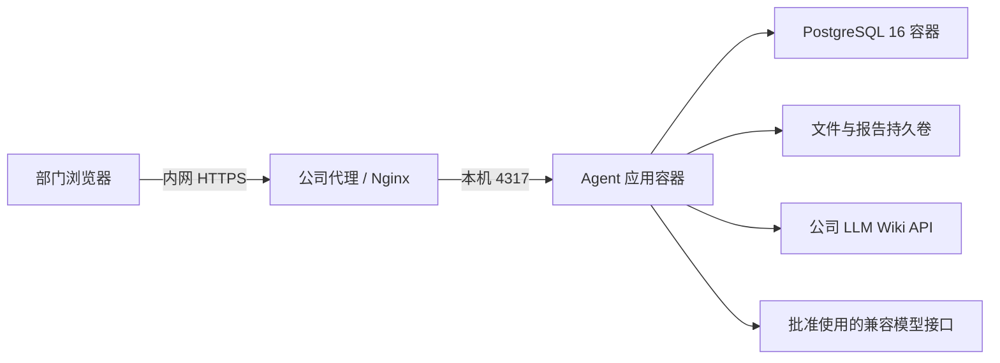

# 公司内网测试部署方案

## 1. 范围与架构

适用于一个部门的小范围测试。默认 Ubuntu 24.04 LTS x86_64；已有公司 Linux 标准可沿用。建议起步 4 核 CPU、16GB 内存、100GB SSD，不需要 GPU；这是容量估算，需要用实际文档和 2 个并发 Agent 任务确认。先单实例运行，不开启应用多副本。



PostgreSQL 不发布主机端口；4317 只绑定 127.0.0.1。由 IT 给测试域名配置公司内网 DNS、HTTPS 证书和访问范围。公司已有 HTTPS 网关时，复用网关，无需重复安装 Nginx。

## 2. 部署前准备

- IT 提供服务器、部署账号、内网域名和可信证书；访问范围先仅限负责人，完成管理员初始化后再开放测试人员。
- 安装 Docker Engine 和 Compose 插件，使用公司批准版本；Ubuntu 官方安装指南：https://docs.docker.com/engine/install/ubuntu/ 。在现有服务器上安装或升级 Docker 由 IT 评估，避免影响其它容器。
- 服务器构建需要访问 npm 和容器镜像仓库。无法访问时，在公司批准的构建机器构建镜像，导入内部镜像仓库；目标服务器用 `docker compose up -d --no-build` 启动。构建镜像架构须与目标服务器一致。
- 确认应用容器可访问模型 HTTPS 接口、LLM Wiki API；外部模型只使用公司批准发送的资料。若公司代理签发内部 CA，需要在构建和运行镜像的系统信任库安装公司 CA，不能关闭证书校验。Windows 本机证书配置不会自动进入 Linux 容器。
- 准备独立测试模型 Key、Wiki token 与测试知识库项目。优先使用脱敏招标文件。

首次部署建议建立全新的服务器测试空间。不要把本机 `data/postgres` 目录当作 PostgreSQL 容器的数据目录；PGlite 和外部 PostgreSQL 的文件不能直接互拷。需要迁移本机成果时，另行安排逻辑导出、文件复制、密钥迁移与恢复验收。

## 3. 上传代码与配置

将源代码放到部署账号可写的 `/opt/tender-agent-test`。至少包含 Dockerfile、compose.yaml、package.json、pnpm-lock.yaml、pnpm-workspace.yaml、tsconfig.json、vite.config.ts、index.html，以及 server、web、shared、agent、tests、deploy 目录。不上传本机 node_modules、data、dist、密钥或真实文件。

下面的初始化只创建本项目配置文件，不修改系统服务；风险低。已有 `.env` 时先备份并编辑，不能覆盖。新环境配置错误时修改 `.env` 后重新创建 app；首次创建的数据卷保留，不使用 `down -v`。

```bash
cd /opt/tender-agent-test
test ! -e .env
cp deploy/company.env.example .env
chmod 600 .env
openssl rand -hex 24
openssl rand -hex 32
```

将两个生成值分别填写到 `.env` 的 `POSTGRES_PASSWORD` 和 `APP_ENCRYPTION_KEY`。两者使用不同值，不把密钥发到聊天或提交代码仓库。数据库密码建议保留十六进制形式，避免连接 URL 的特殊字符转义问题。固定加密密钥必须妥善备份，更换后旧模型/Wiki 密钥无法解密。

默认：HTTPS cookie、并发 2、每 40 轮自动压缩、总预算 400 轮、连续 12 轮无进展暂停、30 分钟任务超时。调整 `.env` 后需重新创建应用容器，单纯 `restart` 不更新环境变量。

## 4. 构建并启动

影响范围：本 Compose 项目的 app/db 容器与独立数据卷；风险中。首次启动创建空测试数据库，升级会执行应用 schema 迁移，升级前必须做备份。只需启动/重建本项目容器，不需要重启 Docker 或其它公司服务。启动失败查看日志；已有环境回滚使用第 8 节的镜像与备份，不删除数据卷。

```bash
docker compose config --quiet
docker compose up -d --build
docker compose ps
docker compose logs --tail=100 app
curl --fail http://127.0.0.1:4317/api/health
```

健康检查应返回 `ok: true`、`storage: postgres`。不运行无参数的 `docker compose config`，避免把完整密钥打印到终端记录。

## 5. HTTPS 入口

`deploy/nginx.company.conf.example` 假设代理运行在同一宿主机。请 IT 替换域名和证书路径，并作为独立站点配置接入，保留 Host，不重写浏览器 Origin。代理在另一台服务器时，当前 127.0.0.1 绑定不可直接访问；需由 IT 设计专用内网监听与来源限制后再调整。

影响范围：本项目的 HTTPS 站点；风险中。重载 Nginx 会应用整个 Nginx 配置，须先检查。回滚：恢复此前的站点文件；新建站点则将本项目配置移出启用目录，再检查并重载。仅需重载 Nginx，不需要重启 Docker、应用或数据库。

IT 安装并备份配置后执行：

```bash
sudo nginx -t
sudo nginx -s reload
```

`COOKIE_SECURE=true` 时通过 HTTPS 域名登录；直接访问 HTTP IP 会导致登录 cookie 不被发送。不要绕过浏览器证书警告，应让 IT 使用公司终端信任的证书。

## 6. 初始化与联通检查

1. 负责人通过内网 HTTPS 域名创建管理员，随后创建测试账号、项目和成员。
2. 在「连接与运行设置」填写公司批准的模型地址、模型 ID、Key 和实际上下文长度，测试模型连接。
3. 填写 LLM Wiki 地址与 token，测试知识库连接，创建项目时绑定正确的知识库项目。
4. Wiki 位于另一台机器时使用其内网地址；位于 Docker 宿主机时可使用 `http://host.docker.internal:19828`。容器中的 `127.0.0.1` 是容器自身。Wiki 需允许来自应用容器的网络访问并启用 token；调整 Wiki 监听由其负责人负责。
5. 用一份脱敏文件完成：上传 → 抽取 → 人工确认 → 匹配 → 复核 → 完整报告及 SPS 销售清单导出。

## 7. 测试验收

| 项目 | 验收方式 |
|---|---|
| 文件与原文 | DOCX/XLSX/PDF 各选样本，检查末页条款、限定词和行号，扫描 PDF 应明确提示 OCR |
| 权限 | 非成员不能访问项目、原文、证据和报告；人工结果不被 Agent 覆盖 |
| 长任务 | 跨过 40 轮应自动压缩并继续；刷新或关闭浏览器不取消任务 |
| 故障 | 测试停止、模型限流、Wiki 不可用；服务重启后已有结果存在，可恢复而不重复写入 |
| 质量 | 人工核对强制项、误判、产品版本、依赖和规格边界；自动测试不代替业务质量验收 |
| 商业清单 | 去重名称、型号、完整规格、单位、报价说明；缺失单价不能变成 0，数量由明确来源或销售确认 |
| 负载 | 2 个项目同时运行，记录内存、磁盘、耗时与 token 成本，再决定提高并发 |
| 恢复 | 在另一台测试服务器恢复备份，检查登录、文件、证据、报告和密钥解密 |

测试期建议每天记录成功/失败任务、人工纠正项、耗时与模型费用。当前自动恢复仍保留总预算、超时和无进展保护；实际费用统计面板尚未实现。

## 8. 备份、升级和回滚

备份需同时包含数据库、上传文件、报告以及加密密钥/部署配置。`deploy/backup-company.sh` 从项目根目录运行，会暂时停止 app，数据库保持运行；正在执行的 Agent 会中断，已有结果与检查点保留，恢复服务后由用户续接。风险中，安排维护窗口，无需重启 Docker。脚本正常或失败退出都会尝试重新启动 app；若进程被强制结束，手动 `docker compose start app`，再检查 health。备份目录权限受 umask 077 控制，含敏感配置，需要受控异机保存。

```bash
bash deploy/backup-company.sh ./backups
docker compose ps
curl --fail http://127.0.0.1:4317/api/health
```

首次恢复演练只在**新的测试服务器与空数据库**进行，不对已有业务数据库执行恢复。将相同版本代码和原镜像准备好，将备份 `deployment.env` 恢复为根目录 `.env`；保持原密钥。以下操作会写入恢复环境的数据库和文件卷，风险中；恢复失败停止该恢复环境，保留原备份与原服务，不影响来源服务器。

```bash
docker compose up -d db
docker compose exec -T db pg_isready -U tender -d tender
docker compose exec -T db pg_restore --exit-on-error --no-owner --no-privileges -U tender -d tender < backups/SELECT_BACKUP/database.dump
docker compose run --rm --no-deps -T --entrypoint tar app -C /app/data -xzf - < backups/SELECT_BACKUP/app-data.tgz
docker compose up -d --no-build app
curl --fail http://127.0.0.1:4317/api/health
```

`SELECT_BACKUP` 必须替换为实际目录。数据库 readiness 成功后才执行 pg_restore。备份不包含应用镜像，必须另行保存对应版本的镜像或放在内部镜像仓库。

升级前备份并保存旧镜像标签；新版本用新的 `APP_IMAGE` 标签构建，验证后启用。仅配置更新时执行 `docker compose up -d --no-deps app`。若没有 schema 变化，可恢复旧配置/镜像标签并重新创建 app；有 schema 变化时不能假设旧代码兼容，需在隔离恢复环境还原升级前数据库、文件和配置，验收后由 IT 切换入口。恢复旧备份会回退升级后的业务写入，切换前明确恢复时间点。

当前方案已整理并可进行 Compose 静态校验，未在公司服务器执行安装、容器启动、代理配置或恢复演练。实际容器部署验收需按上述步骤完成。

## 任务等待与异常恢复

公司模板默认模型无流式活动超时为 120 秒，单次模型请求上限为 600 秒，总任务上限为 30 分钟。三个限制分别由 `MODEL_IDLE_TIMEOUT_MS`、`MODEL_REQUEST_TIMEOUT_MS`、`RUN_TIMEOUT_MS` 控制；1M 上下文不会取消时间和无进展保护。公司网关若需要更长的首字等待，可调整无活动超时，再重新创建 app 容器使环境变量生效。

执行期间对话内每 5 秒同步当前动作、已保存条款/评估数量和耗时。暂时断网后自动补读事件；不要重复提交任务。模型超时、部分临时错误及不兼容工具文本最多自动恢复两次，仍失败会显示可恢复中断。服务重启不会盲目重放工具写入，需在页面恢复执行。

升级本次版本没有新增数据库迁移。更新前按上述方法备份并保留旧镜像，在没有活动任务时重新构建 app；更新后刷新浏览器以加载新的界面资源。测试长任务时核对每轮动作、最终状态和恢复后的条款去重，并检查已保存结果及人工确认保持完整。
