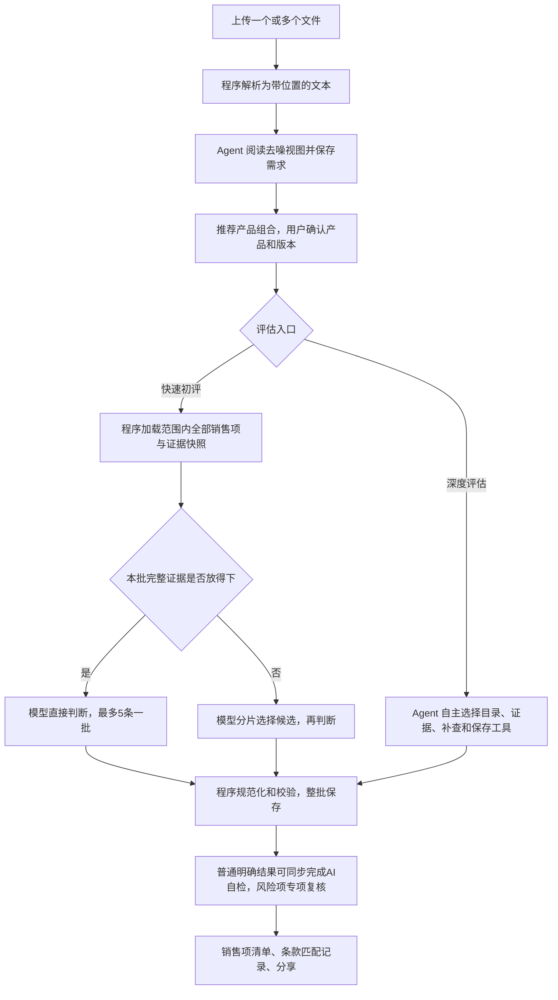

# 评标AI 项目落地分析报告

日期：2026-11-05。审查基线：本地 main，包含 Agent 观测功能；本次修复尚未提交。

## 1. 结论

当前项目已经具备内部试运行所需的完整业务骨架：账户隔离、文档解析、产品版本确认、结构化知识发布、证据快照、评估保存、复核、两类成果导出和分享。主要短板不是缺页面，而是**执行过程仍有较大的模型调用成本，失败影响范围过大，真实业务质量尚未形成可重复验收标准**。

优先保留现有框架与数据资产，把评估主路径做成可测量、可局部重试的流程。暂不建议为解决慢和不准直接更换 Agent 框架或知识库。

本报告基于源代码、配置模板、本地自动化测试及小型复现。没有访问公司知识库、生产 PG、真实模型调用记录或销售人员的验收数据，也没有本轮浏览器人工验收。因此下面区分确定的代码行为、可能的业务影响和需要线上验证的假设，不给出虚构的准确率或提速百分比。

## 2. 当前真实链路

快速初评和深度评估并非相同执行器。前者由程序编排、模型批量判断；后者仍有多轮决策和工具调用成本。仅优化快速初评，不能推导出深度评估同样提速。

知识来源也有两条路径：绑定结构化发布的项目使用固定知识版本渲染实体；历史 Wiki 项目保留 Wiki 来源。`server/structured-knowledge.ts` 明确避免自动转换已有项目。导入新数据或调整知识配置，并不等于所有历史项目已经切换。

## 3. 主要发现与优先级

### P1：固定每批5条、模型判断串行，全文会在不同批次重复输入

证据：`server/assessment-pipeline.ts` 有两个准备工作线程、一个消费端，每次消费最多5条；`server/quick-assessment.ts` 的 `planQuickBatches` 同样限制5条。`judgmentPayload` 会在单次请求内去重证据，但跨批次仍重新发送正文。

影响：127条清单即使全部一次判定成功，也至少需要26次批量判断请求。以假设的每次30秒计算，单这一阶段就是约13分钟；这只是计算示例，不是本轮实测。200项、每项500字约10万字全文，若26批都带入，输入字符累计约260万，尚未计入指令和其他字段。大上下文解决“装得下”，不能保证“处理得快”。

建议：先统计每批输入量、首响应时间、完成耗时、保存耗时和输出量，再用真实清单对比5/10/15条批次及1/2路判断。按上下文和输出预算自动组批，而非直接无限加大。多条共享完整证据放在稳定前缀，是否命中供应商缓存以实际 usage 为准。保留完整目录；不要靠任意截取前三个候选换取速度。

### P1：一个条款保存失败，可能使整批条款重复请求模型

证据：`server/assessment.ts` 的 `saveAssessments` 对整批使用一个事务；`server/quick-assessment.ts` 把模型判断和整批保存放在同一个两次尝试循环中。保存失败后下一次尝试会再次调用判断模型。

影响：一条错误证据或结构字段使其他有效条款一起回滚；用户看到“已判断增加、已保存不动”。之前大量 traceId、证据行号报错放大了这一成本。

建议：保留模型原始判断，对结构错误先程序修复；按条款隔离保存失败，成功项先入库。只有确实需要重新推断的失败条款才再次请求模型。需要保持范围版本检查和人工结果保护，属于后续流程改造，不在本轮小修中直接改变事务语义。

### P1：默认15分钟任务上限仍会中断长任务，且排除自动恢复

证据：`server/config.ts` 的 `RUN_TIMEOUT_MS=900000`；`server/agent.ts` 两处恢复判断都含 `!timeout`。连接问题有恢复机制，但任务总超时属于另外的停止条件。

影响：即使模型每次都正常返回，任务仍可能到时间终止。换高性能 Wiki 服务器不能解决这类中断。

建议：将一个业务评估与单次执行分开，按已保存条款续接后续执行；设置累计预算与无进展保护。页面区分“单次请求超时”“执行时间预算耗尽”“无进展暂停”。临时提高时间配置只能缓解，不能替代恢复机制。本轮未擅自更改公司部署预算。

### P1：新旧复核指令同时进入模型上下文

证据：`server/agent.ts:systemPrompt` 规定只对待复核风险项专项检查，但又从 `agent/product-matcher.md` 拼接第二至第四部分；第四部分仍要求“逐条匹配完成后，必须逐条复核”。虽然新规则声明优先，模型仍会看到两套要求。旧输出格式第五部分已被截除，不应误认为它也全部进入当前提示词。

影响：深度 Agent 可能再次逐条检查，或反复解释规则。此问题尤其值得用观测记录核实。

建议：把运行时业务规则收敛到一个来源，保留旧文档作为历史参考；自动检查运行时提示词是否包含已废弃的逐条强制复核、旧目录结构等指令。不能仅继续在提示词顶部增加“最高优先级”。

### P1：准确性还缺少公司真实清单的金标准闭环

证据：`scripts/evaluate-accuracy.ts` 默认读取 `syntheticAccuracyCases()`，注释明确不调用数据库或模型。现有测试对证据、版本、权限等约束有价值，但不是线上匹配准确率的证明。

影响：规则不断增加，却难以区分文档漏提取、产品选错、候选漏召回、规格误读、判断错误和保存失败各占多少。

建议：选取至少3份典型清单和50～100条售前确认的样例，覆盖普通功能、数值参数、否定条件、跨产品组合、已有组件复用、无对应能力。每条标注原文位置、产品版本、应匹配销售项、可接受结论和证据。跟踪需求漏提率、正确销售项进入候选的比例、错误“完全满足”率、人工修改率、每百条耗时；固定数据版本后再比较模型或提示词。

### P1：证据真实不等于业务结论正确

证据：`server/assessment.ts` 可以验证快照、行号、摘录、实体和贡献关系；`server/assessment-review.ts` 只允许明确、原生、无专项风险的结果同步完成AI自检。复杂条件的语义覆盖仍主要依赖模型。

影响：“支持录像”不能证明“支持指定协议接入并保存90天”；两个产品各有功能不能证明已完成集成。单条长需求容易被其中部分命中内容带偏。

建议：用户仍以原条款为单位阅读，内部统一维护对象、动作、数量/单位、条件、否定、交付前提的核对表。关键约束缺失时保留部分满足或待确认。无需恢复强制人工登记父子要求的旧交互；同一 Agent 自检也继续明确标识，不能包装成独立复核。

### P2：文档解析的质量上限需要显式展示

证据：`server/documents.ts` 支持 Word 表格转文本、Excel按行读取；PDF按文本项Y坐标和换行拼接，没有OCR或完整表格布局恢复。`server/requirement-document.ts` 的去噪基于规则并保留原文位置。

影响：扫描件无法直接处理；多栏PDF、跨页表格、合并单元格以及一个单元格中的长段落仍需要真实样例验证。精确引用行号无法证明一开始就没有漏行、串列或误分段。

建议：上传后显示有效正文行数、表格/页数和解析异常，允许快速预览原文与提取结果。用原清单行数与抽取条款数做覆盖核对。对歧义做定位提示，不要求用户逐条重新整理。OCR作为独立能力排期。

### P2：项目页面反复拉取完整项目状态，观测数据仍有增长成本

证据：`web/useWorkspace.ts` 每5秒调用完整项目刷新，工具结束还会触发刷新；`server/api.ts` 项目接口包含全部需求、评估结果、快照元信息和检索轨迹。观测会保存每次完整模型上下文，暂无独立保留期；抽屉分页抓取后仍将记录全部放入浏览器。

影响：数据越多，刷新和渲染成本越高。新观测日志若进入普通聊天流会进一步放大负担，本轮已修复这一点。仅凭源码不能断言它就是公司环境卡顿的唯一原因。

建议：进度接口与业务数据分离，按变更版本增量更新；观测默认只载入时间线摘要，点击再读取请求正文；设置访问控制、保留期和容量指标。需要注意完整上下文本身可能含招标原文，密钥脱敏并不等于文档内容脱敏。

### P2：初评、AI自检和正式导出的完成条件仍有理解成本

证据：`server/reports.ts` 的正式报告需要全部条款确认、匹配、复核；`web/Workpane.tsx` 根据完成状态自动选择正式或初评。风险自检只让部分普通条款直接通过。

影响：用户可能把“全部判断完”理解成“可以正式交付”，随后发现还有复核状态；快速初评的风险项不会因为完成判断自动全部变成已复核。

建议：持续显示已保存/总数、待核实数、未完成数和成果状态。提供只处理失败项、只复核风险项的直接动作。保留当前两类成果和初评可下载能力，未知结论应在报告中明确呈现，不能为了导出强行改成满足。

### P2：单实例调度、运维和配置口径需要按部门规模验收

证据：`server/db.ts` 用 PG advisory lock 明确限制单实例；默认同时执行2个任务。`README.md` 已有部署和备份要求，并明确OCR、SSO、分布式Worker未实现。服务运行时读取用户模型配置，项目知识发布则固定版本，两类生命周期不同。README的部分恢复说明与现有自动恢复代码口径有差异。

影响：多用户排队是实际容量问题；简单增加应用副本不可行。每次执行的模型配置、提示词版本、知识版本需要一起留痕，才能复现差异。

建议：近期使用单实例+外部PG，先测2～5名同事并发；明确排队状态和管理员处理方式。验证数据库、上传文件、成果文件及加密密钥的整体恢复。模型参数、提示词版本及知识发布ID写入任务级元数据；在确有容量证据后再拆Worker。

## 4. 本轮直接修复

| 问题 | 复现/依据 | 修复 |
| --- | --- | --- |
| 普通聊天拉取完整模型上下文 | `/runs/:id/events` 原先返回所有事件，新加的 model_request/model_response 也包含在内 | 普通聊天接口排除这两类大事件；独立观测接口保留，增加接口回归断言 |
| 观测抽屉任务结束后仍轮询 | `AgentObservation.tsx` 的 finally 无条件再次设置定时器 | 任务终态且当前分页读完后停止轮询，文案显示已完成同步；请求失败仍允许重试 |
| 空白Excel被视为有效文档 | 实际构造空工作簿，返回仅含 `[工作表：空白清单]` | 只为有正文的工作表生成标题；全空文档按原有422规则拒绝；验证空表+有效表混合场景 |

未修改知识库或生产数据，未改变人工结果保护、证据真实性、产品版本边界和正式报告规则。未替换框架、批量策略或恢复架构。

## 5. 验证结果与限制

- TypeScript类型检查通过；前端Vite、后端tsup构建通过。前端约1.55MB主包体积告警仍存在。
- 全量自动化测试首次运行：93项，91通过、2失败；两项失败计数来自同一个Pi集成子测试及其父测试。日志出现请求超时和重试，预期规划事件缺失。
- 不修改超时配置和断言，独立重跑完整后端测试：16项全部通过。说明存在并行运行下的时序/资源敏感问题，不能把首次失败直接忽略，也不能认定为线上根因。
- 文档解析新增回归及已有去噪测试：4项全部通过。新增文档修复发生在首次全量运行之后，已单独验证；没有声称最终树全量单次全部通过。
- 本轮未做生产负载、真实模型准确性、外部PG部署恢复及浏览器交互验收。

## 6. 建议实施顺序与验收标准

1. **先建立可比较的基线**：固定公司清单、所选产品版本、模型、知识发布和输出参数，采集准备/判断/保存/复核各阶段耗时与重试次数。至少重复3次，区分首次和后续请求；样本足够后统计p50/p95。
2. **解决明显的重复工作**：统一运行时提示词，按条款隔离保存失败，保存重试不再重新判断已成功项。验收：人为制造1条失败，其余有效条款正常保存；再次执行只处理未完成项。
3. **优化判断吞吐**：在同一真实评测集上比较批次与受控并发。建议候选门槛为端到端中位耗时比基线减少30%，同时错误“完全满足”率不增加；这是建议验收目标，不是已达到的效果。
4. **做可靠续跑与风险复核**：网络断开、单次超时、服务重启、总执行时间预算耗尽分别测试；验收：结果不丢失、不重复覆盖人工结果、有进展任务可按规则继续，无进展任务明确停止。
5. **改善结果交付**：默认聚焦匹配结果和待核实项，销售清单明确产品、版本、模块、单位、依赖与数量待核定项。让3名未参与开发的售前独立完成上传、选型、评估、下载，记录需要他人解释的步骤。

上述第2～4项涉及业务执行和状态管理，建议按小批变更逐项上线。先验证“同一份清单能稳定完成、知道哪里慢、错误能局部重试”，再扩大用户和知识库规模。
