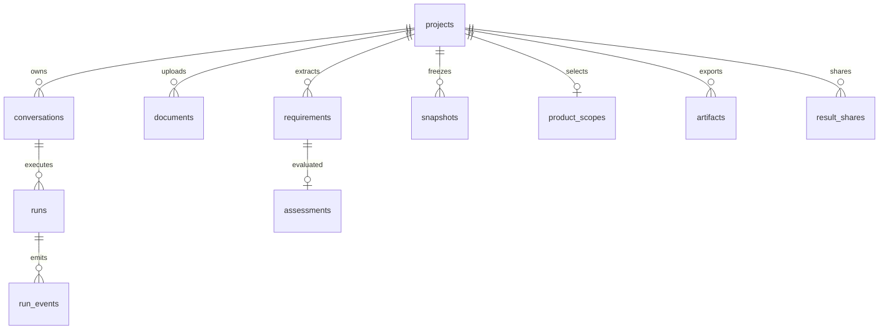
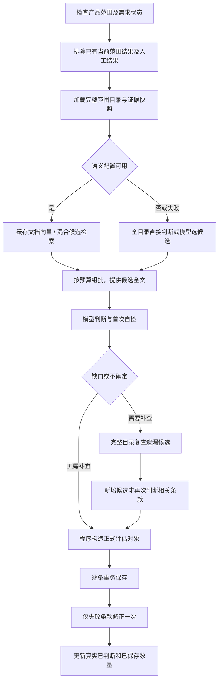
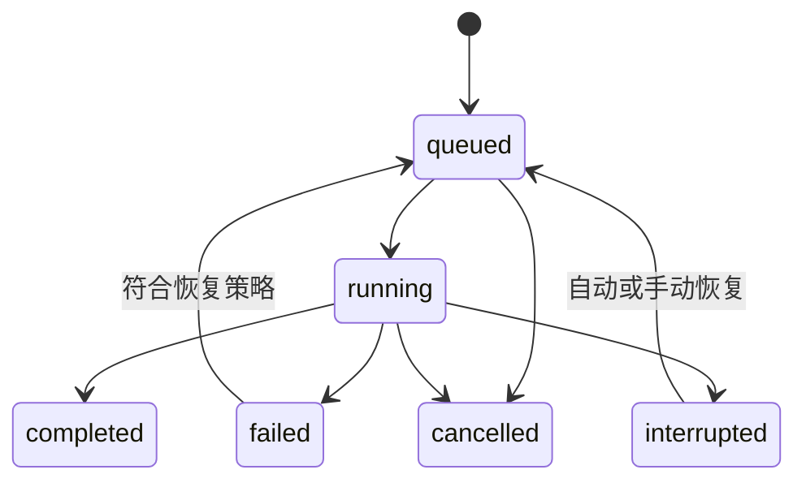

# 评标AI：技术架构与工程原理

文档日期：2026-11-10。适用范围：当前工作区代码，包含尚未提交的语义混合检索、页面配置和 Langfuse 接入。当前 Git HEAD 为 `064e931`，不能仅根据该提交号判断是否具备本文全部功能。

本文用于开发交接、技术评审、内部部署和故障排查。描述的是代码实际行为；不把设计目标、模拟接口测试或合成评测当作公司生产效果。本文不包含真实密钥、账户密码或公司知识库正文。

## 目录

1. 产品定位与能力边界
2. 技术栈与目录结构
3. 系统架构与职责分工
4. 数据模型与知识生命周期
5. 文档解析与需求提取
6. 产品推荐与范围确认
7. 快速初评执行原理
8. 语义混合检索原理
9. 深度 Agent 执行原理
10. 证据、判断、保存与复核
11. 长任务状态、恢复与上下文管理
12. 前端交互与流式显示
13. 成果导出与分享
14. 独立能力检索与知识图谱
15. 可观测性与 Langfuse
16. 接口与权限
17. 配置、部署与运维
18. 测试、真实评测与性能验收
19. 已知限制与后续演进
20. 源码索引与排查手册

## 1. 产品定位与能力边界

评标AI面向公司内部售前：将招标或需求清单中的真实技术需求，与已确认的软件产品版本及其正式销售项进行核对，形成条款匹配记录和销售项清单。

主要业务对象：项目、上传文件、原始条款、产品选型、销售项、证据、评估结论和成果文件。

支持多轮对话、计划管理、工具调用、多文件上传、产品组合选择、快速初评、深度评估、风险复核、人工修订、结果下载和链接分享。另有独立的一句话能力检索入口。

当前需求分析关注功能、性能、接口、兼容性、安全、部署及必要场景约束；评分办法、供应商资质和商务报价不作为本阶段主要评估对象。销售项价格是知识字段，不能自动当成项目成交报价；数量和合价不能缺省推断。

关键边界：

- 相似销售项是候选，不等于满足需求。
- 未检索到、接口失败、原文未描述，不等于明确不支持。
- 用户确认的产品范围是正式匹配边界，Agent不能擅自添加范围外产品。
- 同一Agent自检不等于独立模型复核或人工确认。
- 项目知识版本、产品范围版本、评估记录版本是三种不同版本。

## 2. 技术栈与目录结构

| 层次 | 当前实现 | 作用 |
| --- | --- | --- |
| 运行时 | Node.js ≥22.19，ES Modules | API、后台任务、文件解析 |
| 语言 | TypeScript | 前后端及共享业务类型 |
| 前端 | React 19、Ant Design 5、Vite | 工作台、配置、项目管理、成果页 |
| API | Fastify 5、Zod | HTTP接口、权限、输入校验 |
| Agent | `@earendil-works/pi-agent-core` 1.1.0 | 对话循环、工具调用、状态与计划 |
| 模型适配 | `@earendil-works/pi-ai` 1.1.0 | OpenAI兼容模型调用与流式事件 |
| 数据库 | 外部 PostgreSQL / PGlite | 业务、任务、快照、审计、向量缓存 |
| 文件处理 | Mammoth、ExcelJS、PDF.js | Word、Excel、PDF解析与Excel成果 |
| Markdown | react-markdown、remark-gfm、YAML | 知识正文渲染与实体元数据解析 |
| 观测 | Langfuse tracing/otel、OpenTelemetry NodeSDK | 模型与工具执行追踪 |
| 构建 | TypeScript、Vite、tsup | 类型检查、前端产物、后端打包 |

精确依赖解析以 `pnpm-lock.yaml` 为准，`package.json` 中的范围不是生产环境实际版本的证明。

```text
server/       API、Agent、初评、知识、报告、权限、观测
web/          React工作台、配置页、检索页和分享页
shared/       数据契约、结论聚合、评测与检索辅助逻辑
agent/        当前Agent参考规则
tests/        单元测试、PGlite集成测试、模拟模型和接口测试
scripts/      知识表DDL、Wiki诊断、准确性评测等工具
deploy/       公司测试部署、反向代理和备份脚本
data/         运行数据：数据库、上传文件、成果、密钥等
Dockerfile    多阶段生产镜像构建
compose.yaml  应用部署编排
```

`prompt/`、`extensions/` 中保留历史工作流资料；不应据此认定运行时仍执行旧脚本、旧导出或旧子Agent流程。运行时入口以 `server/agent.ts` 和工具注册代码为准。

## 3. 系统架构与职责分工

```mermaid
flowchart TB
  U[售前浏览器] --> W[React 工作台]
  W --> A[Fastify API / 会话权限]
  A --> DB[(PostgreSQL / PGlite)]
  A --> FS[上传与成果文件]
  A --> R[单实例 AgentRunner]
  R --> PI[Pi Agent 深度执行]
  R --> Q[程序编排快速初评]
  PI --> T[授权项目工具]
  Q --> K[候选准备与证据校验]
  T --> K
  K --> DB
  K --> WK[LLM Wiki API]
  K --> EM[Embedding 服务]
  PI --> LM[兼容对话模型]
  Q --> LM
  R --> O[站内执行事件]
  R -.启用后异步上报.-> LF[Langfuse]
```



| 主体 | 负责什么 | 不应承担什么 |
| --- | --- | --- |
| 程序 | 权限、范围过滤、原文提取、数据准备、缓存、保存、导出、恢复预算 | 凭关键词或相似度直接宣称业务满足 |
| 模型 | 理解需求、比较候选、判断缺口、核查交付与集成条件 | 生成不存在的快照、销售项ID、价格或证据 |
| Pi Agent | 根据对话状态规划步骤、选择工具、补查、解释结果 | 绕过后端校验、越权访问、覆盖人工结果 |
| 用户 | 选择产品版本、核对关键差异、修订或确认业务结果 | 为了让流程运行而手工补数据库内部字段 |

工程核心是将确定性事实交给程序管理，将语义判断交给模型，并将判断绑定到可追溯事实。

## 4. 数据模型与知识生命周期

### 4.1 业务数据库

| 表 | 用途与关键关系 |
| --- | --- |
| `users` / `sessions` | 用户、角色、活跃状态；数据库保存会话Token哈希 |
| `settings` | 全局Wiki等设置 |
| `user_agent_settings` | 各账户独立模型连接、多模型配置 |
| `semantic_settings` | 管理员统一Embedding配置，密钥加密 |
| `projects` / `project_members` | 项目、归属、成员、归档状态 |
| `conversations` | 会话、对话上下文、计划、检查点 |
| `runs` | 一次任务、状态、模式、幂等键、轮数、自动恢复次数 |
| `messages` | 用户与Agent可展示消息 |
| `run_events` | 执行进度、工具调用、模型观测和终态 |
| `documents` | 文件元信息、原文件定位、哈希、解析文本行 |
| `requirements` | 项目内T编号、原始需求、文件和行号、确认状态 |
| `product_scopes` | 推荐、方案组合、确认产品、范围revision |
| `snapshots` | 项目内知识原文及哈希；唯一键为项目、路径、内容哈希 |
| `assessments` | 条款评估、来源、复核标记、revision |
| `audit_log` | 业务修改、检索与耗时审计 |
| `artifacts` | 成果文件、磁盘定位、格式和生成清单 |
| `result_shares` | 分享Token哈希、冻结结果、成果ID、过期和撤销状态 |
| `embedding_cache` | 内容哈希对应向量JSONB，属于可再生成的派生缓存 |
| `kb_search_documents` / `kb_search_vectors` | 后台预处理的全文检索索引、原生 pgvector 分块向量和证据映射 |
| `kb_index_state` / `rerank_settings` | 持久增量索引队列及管理员精排连接配置 |
| `capability_sessions` / `capability_pages` | 独立能力检索的会话及历史证据页 |



图中省略复合主键和部分外键。`requirements.id` 仅在项目内唯一，不能只用 `T-1` 跨项目定位。

### 4.2 结构化知识

导入表位于 `public` schema：

| 表 | 商业含义 |
| --- | --- |
| `kb_products` | 产品标识、名称、产品线、部门、负责人、场景与边界 |
| `kb_product_versions` | 产品版本、支持状态、交付和集成说明 |
| `kb_categories` | 版本内销售项分类 |
| `kb_sale_items` | 版本内正式销售项、模块编码、规格、计价、前提和限制 |
| `kb_sale_dependencies` | 销售项之间的必选、条件或可选依赖及原始依据 |

完整导入DDL见 [scripts/product-knowledge-schema.sql](scripts/product-knowledge-schema.sql)。模块编码和销售项名称不能代替全局稳定 `sale_item_id`。

当前已取消知识发布：新项目直接读取 PG 启用记录，不创建或绑定 `kb_releases`。这两张旧发布表只保留历史兼容。新增 `kb_product_overviews` 保存按产品版本生成的结构化概览及销售项依据，新增 `kb_index_state` 记录向量索引状态。业务维护即时影响新检索，引用时仍创建不可变证据副本，历史评估和报告不自动改写。内部兼容字段 knowledgeReleaseId 对新数据表示固定 PG 来源标识，不表示发布快照。

互相依赖可以代表共同购买或组合授权，不等于知识错误。代码通过强连通分量识别依赖组；解释依赖时仍需保留具体条件和原文，不凭图关系推导接口兼容或授权共享。

### 4.3 Wiki路径约定

```text
wiki/overview.md                    固定产品总览入口
wiki/entities/products/*.md          产品页：按版本列销售项
wiki/entities/sale-items/*.md        销售项正式实体
```

当前匹配不再依赖 `versions/` 版本页或 `sales/` 分类页。历史Wiki可能存在不同结构，必须按实际路径解析，不能把本地知识库结构当成公司线上结构。

新项目的知识来源固定为 PG，无需选择 Wiki 知识空间。历史 Wiki 文件证据和旧发布数据保留兼容读取；已有评估不会因维护 PG 而自动重跑。

## 5. 文档解析与需求提取

### 5.1 输入解析

- 支持 `.docx`、`.xlsx`、`.pdf`、`.md`、`.txt`；旧 `.doc/.xls` 需转换。
- 前端支持多文件队列，后端每次上传接口接收一份文件；并非一个multipart请求直接解析整个项目的全部文件。
- 单份文件上传限制25MiB；API路由具有相应body限制。
- Word转换HTML后保留表格行和单元格分隔；Excel逐可见工作表按行读取，空工作表不作为有效正文。
- PDF提取文本项、坐标换行和页码；没有内置扫描件OCR，也不是完整表格版面识别器。
- 文本按UTF-8解码；解析结果最多50,000行、约400万字符，超限要求拆分。

### 5.2 原始文本与去噪视图分离

`documents.lines` 保存原始解析行。`requirementDocumentView` 生成阅读视图，排除目录点线、页码、重复页眉及部分评分资质噪声，但不重写原文行号。

工程意义：去噪可以调整，证据位置不能随显示优化漂移。需跨行引用时保留连续原文，不能跨噪声行拼造一段“新原文”。不同子系统中的相同句子也不能仅因文字相同就去重。

### 5.3 需求记录

条款包含 `id`、`documentId`、`module`、`type`、`raw`、`lineStart/lineEnd`，可包含 `subrequirements`。T编号属于原始业务条款，当前不强制人工预登记父子要求，不要求每条至少拆两个核验点。

需求提取仍依赖模型理解章节、表头、对象、动作、数值、否定和例外。去噪规则不能证明需求覆盖完整；`source_coverage` 用于记录原文条目与已提取需求的对应关系。快速流程会自动准备条款确认状态，深度流程按账户配置处理。

## 6. 产品推荐与范围确认

1. 程序读取固定总览，或从结构化发布渲染总览。
2. 模型按整份需求推荐候选产品及1～3套组合方案，填写产品分工与缺口。
3. 前端提供AI推荐和自主选品，查看版本及分类销售项。
4. 用户确认后持久化 `product_scopes.selected`，增加revision。
5. 后续检索与保存使用该范围；范围外产品只能单列替代建议。

推荐不自动等于已选择。产品范围revision变化后，旧范围下的评估不能当成新范围结果。数据通过 `expectedRevision` 防止旧页面覆盖新选择。

## 7. 快速初评执行原理



完整目录由程序加载，是检索集合和身份校验基础；启用语义检索后，不等于每批都把全部正文送给判断模型。

准备阶段有两个工作线程，有界队列提供背压；判断消费并发由 `QUICK_CONCURRENCY` 控制，默认2、上限3。`QUICK_BATCH_SIZE` 默认10、上限20；实际批量还受到 `floor(maxOutputTokens/1000)` 和输入字符预算限制。例如输出上限8192时，生产入口条数上限通常为8，而非固定10。

输入预算估算为：

```text
max(1000, floor((contextWindow - maxOutputTokens - 4000) × 1.2)) 字符
```

这是保守估算，不是精确Tokenizer。单条过大仍可能超预算，不能假设配置1M上下文即可无限组批。

`judgmentPayload` 将相同snapshotId正文在单次请求内共享；候选仍保留条款内局部编号。共享证据放到请求前部有利于供应商前缀缓存，但不保证缓存命中，也没有实现“只发一次全文、之后引用即让远端模型永久记住”的能力。

判断结果必须恰好覆盖本批条款。模型判断或结构错误有有限重试；保存采用逐条调用 `saveAssessments`，单条失败不会回滚同批其他成功项，只对失败条款反馈错误并尝试一次修正。深度Agent若直接批量调用保存工具，保存函数本身仍保留整批事务语义，不能笼统认为所有入口都已逐条隔离。

## 8. 语义混合检索原理

### 8.1 数据准备和缓存

Embedding连接独立于对话模型。管理员在页面配置地址、模型、密钥、超时、模型revision和候选数；模型必须能返回向量，不能填普通聊天模型代替。

实体正文按约1400字符步长切分，每段最多取1600字符，即相邻段约200字符重叠；各段附产品、版本、销售项前缀。分段是按字符窗口，不是语义段落解析。索引命中后回取完整实体作为证据，不将截断向量段直接当最终规格。

```text
namespace = API地址 | 模型名 | 模型revision | catalog-v1
cacheKey = SHA256(namespace + 换行 + 文本)
```

文档段和检索查询均可缓存。未命中文本每批最多32条调用标准 `POST /embeddings`。返回要求每条有唯一index和非零、有限、维度一致的向量，程序按index还原顺序。

当前 PG 检索使用 `kb_search_vectors.embedding` 原生 pgvector 类型，在数据库内完成范围过滤、余弦距离和 TopK，不向 Node.js 加载全库向量。`embedding_cache.embedding` JSONB 只用于请求去重和旧 Wiki 兼容。当前使用精确检索，未启用 HNSW/IVFFlat 近似索引。后台预构建 `kb_search_documents` 的分词、检索文本和证据映射，触发器将直接 SQL 和页面维护变化写入 `kb_index_state` 持久队列；查询不承担销售项向量化。索引、向量和缓存仍属于派生业务数据，不能视为自动匿名化。

更换模型权重或维度、但沿用相同服务地址和模型别名时，必须更新模型revision；否则旧向量可能被复用。缓存尚无自动保留期与后台清理策略。

### 8.2 需求查询

PG 检索查询由原条款和已有子要求组成并去重，查询向量批量缓存；不额外调用模型做原子需求拆解，用户原始条款保持不变。旧 Wiki 兼容路径还保留按分号/句号/换行规则拆句。

### 8.3 向量、关键词与融合

语义分数为精确余弦：

```text
cos(q,d) = dot(q,d) / (||q|| × ||d||)
```

同一实体有多个分段时，取最高段分数作为该查询下的实体语义分数。维度不同直接报错，不把两种向量强行比较。

关键词来自 `shared/retrieval.ts` 的规范化、少量同义词扩展、中文二元片段等。PG 后台预建 tsvector/GIN 索引，名称设为 A 权重，正文使用默认权重，查询使用 ts_rank_cd 排名；这是 PostgreSQL 全文检索，不是 BM25。旧 Wiki 内存路径仍使用名称4、正文1的词项权重。

每个查询分别得到语义和关键词排序，默认候选池为最多 `3 × topK`（上限100）；启用精排时采用配置的候选池且不少于 topK，再通过倒数排名融合：

```text
RRF(item) = Σ 1 / (60 + rank + 1)
```

候选可调用独立的 `/rerank` 模型精排后取 topK。服务未配置时不启用，超时或故障明确回退原召回排序并提示，不把精排得分或相似度当作“满足/不满足”的判定线。TopK 默认10，检索接口支持1～100。后台每2秒领取索引任务，每批最多32项，每轮最多8批；失败指数退避至多5次，支持人工重试和模型版本变化后重新调度。

### 8.4 回退与边界

- 范围由已确认产品版本决定，先限定集合，再计算排名；不会先全局Top K再过滤产品。
- 未启用或缺配置时使用原目录方案；初始化或查询异常记录 `semantic_fallback`。
- 未启用语义时，全文能装入预算则直接提供全量；装不下时用模型分片选择候选。
- 语义候选判断为部分满足、未知或不匹配时，当前快速流程可通过完整目录选择器复查；没有新增候选时跳过重复判断。
- 当前未实现自动沿依赖边展开所有前置销售项。依赖仍需根据实体关系和后续核验处理，不应把“候选召回”当作“采购依赖闭包已齐备”。

首次索引构建发生在后台，完成后新内容参与检索；未就绪时页面明确提示覆盖不足。快速初评和深度 Agent 的 PG 候选共用数据库检索，但完整目录兜底和证据准备仍有独立开销。检索分段耗时与人工标注评测用于定位真实性能和召回率，不承诺仅更换数据库就消除整个任务耗时。

## 9. 深度 Agent 执行原理

`AgentRunner` 创建Pi Agent，装配系统提示词、用户个人模型连接、已有上下文与项目授权工具。Agent自主在“模型返回 → 工具调用 → 工具结果 → 再次模型请求”的循环中推进。

模型请求采用OpenAI兼容适配器；兼容地址不意味着每个供应商都完整支持工具调用、流式输出和相同上下文限制，需实测。

| 工具组 | 代表工具与职责 |
| --- | --- |
| 项目状态 | `project_context`、计划更新、已有结果查询 |
| 需求 | 读取文档、保存条款、原文覆盖登记 |
| 选型 | `product_search` 检索版本概览、PG 总览、推荐产品与组合 |
| 匹配 | `assessment_search`、`assessment_catalog`、`assessment_evidence` |
| 补查 | `wiki_read`、范围内换词与目录核查；PG 项目禁止全局补查 |
| 结果 | `save_assessments`、`get_assessments`、`review_assessments`、`export_report` |

工具通过Zod生成参数JSON Schema，并由后端执行项目级权限与业务校验。工具执行为顺序模式；快速初评的程序并发不等于Pi工具并行。

深度Agent优先 `assessment_search`；available=false或失败时回退目录/实体工具。工具可检索候选，但不替用户确认产品范围。旧规则仅保留严格判断与判定速查部分，旧的强制全量逐条复核段不再注入运行时。

## 10. 证据、判断、保存与复核

### 10.1 证据契约

每条引用为 `snapshotId + lineStart + lineEnd + quote`，必须来自本项目已获取的知识快照。知识更新生成新哈希/新快照，不把历史证据正文原地替换。

后端校验实体所属产品与版本、正式销售项身份、原文摘录、行号与贡献项；新项目不要求知识发布。标题或元数据不能替代能力正文。

兼容修复只处理确定性格式问题：单元素sales数组转换成字符串；同一快照中摘句唯一匹配时修正空白与行号。多处同文、原文改写、外项目快照或不明确名称不会自动猜测修复。多行原文引用可以合法，不能误解为“只能引用单行”。

### 10.2 结论和贡献

| 值 | 意义 |
| --- | --- |
| `exact` | 对需求范围与条件有充分满足证据 |
| `partial` | 部分满足，缺口必须指出 |
| `no_match` | 明确不匹配，需要可靠反向依据 |
| `unknown` | 证据、条件或交付方式不足以确认 |

贡献项purpose区分 `purchase`、`dependency`、`existing`、`optional`、`candidate`。已有组件不应重复列为采购；候选或可选项不能直接进入正式采购清单。同名销售项跨产品/版本有不同身份，不能只按显示名称合并。

交付方式包括原生、配置、集成、定制、外部和未知。跨产品组合需说明接口、方向、版本兼容、配置及授权；不能根据两端分别具备功能就宣称联动成立。

### 10.3 保存与并发

`assessmentSchema` 验证结构，程序做确定性规范化，再检查范围、原文与贡献关系，事务内写入并增加revision。人工来源记录受保护，Agent不能覆盖。复核引用真实revision；冲突时重新读取，不猜测版本号。

### 10.4 风险分层复核

首次判断可提交方向、范围、参数、场景、交付五项selfReview。只有普通明确、原生、证据齐全、无专项风险的结果可同步标记AI自检完成。

数值/否定条件、非exact结果、定制或集成、依赖或复用、候选贡献、证据不足等仍列为专项风险。独立人工确认与同Agent自检必须在页面和成果中如实区分。

## 11. 长任务状态、恢复与上下文管理

### 11.1 调度和幂等

任务在同一应用进程内轮询领取，默认最多同时执行2个项目任务。数据库部分唯一索引保证同一项目只存在一个queued/running任务；提交幂等键按用户唯一，网络重试沿用键，避免重复新建任务。

外部PG连接通过advisory lock阻止第二个工作台实例同时运行。当前不是分布式Worker架构，不能直接水平扩容多个应用副本。



### 11.2 三种时间限制

- `RUN_TIMEOUT_MS`：单次执行时间预算，默认15分钟。
- `MODEL_REQUEST_TIMEOUT_MS`：单次模型请求最长10分钟。
- `MODEL_IDLE_TIMEOUT_MS`：流式无活动约2分钟触发中止。

本轮代码已允许总执行超时进入后台恢复策略；并非删除时间预算。网络、限流等暂时故障可恢复，认证、无效模型、输入校验等不能盲目重试。

后台自动恢复默认最多3次，退避约3/10/30秒，并受总轮数、取消、其他活跃任务等约束。模型循环内部还有最多2次即时恢复；两层恢复不可混为一个次数。

恢复沿用同一任务和已存状态；快速初评跳过已有当前范围结果。它不是通用的分布式exactly-once执行保证，不能承诺远端工具副作用绝不重复。

### 11.3 上下文压缩与检查点

会话持久化Pi消息上下文及检查点，后者包含摘要、成功读取的文档行范围和压缩次数。准备模型请求时结合序列化长度和已有Token用量判断是否压缩；`MAX_AGENT_TURNS` 当前也用于周期性检查/压缩，而非简单到40轮就永久结束。

压缩总结既有事实并保留恢复所需信息。中断的工具调用会补上“可能已保存，先查询事实”的恢复结果，避免模型误把未完成调用当作成功。

## 12. 前端交互与流式显示

前端通过 `/runs/:id/events?after=cursor` 轮询事件，并将 `text_delta` 拼接成流式文字。这是服务端流式模型输出加前端增量轮询显示，不是浏览器直连模型，也不是浏览器与后端之间的SSE/WebSocket。

普通聊天事件每页最多200条；模型完整输入输出由独立观测接口读取，不进入普通聊天轮询。前端保留最近500条事件用于显示；完整记录仍在数据库。

执行期间项目状态约每5秒刷新，工具完成等事件也可能触发刷新。当前项目接口包含较完整业务数据，尚未完全拆成细粒度增量接口，大项目需要关注刷新负载。

页面包括项目管理、对话、产品选型、需求/评估、证据阅读、成果、项目留痕及管理员设置。左右面板支持宽度调整、侧栏收缩；具体布局由现有组件与CSS控制。

## 13. 成果导出与分享

默认两份XLSX：

1. 销售项清单：正式销售项、产品、版本、规格、价格及待核定事项。
2. 条款匹配记录：原需求、产品销售项、结论、满足项、缺口、证据与复核状态。

正式导出需要条款已确认、全部有匹配记录且已复核；未完成时可导出带覆盖范围和缺项提示的初评成果。保留部分旧格式内部接口是兼容历史文件，不代表页面继续提供所有旧选项。

报告生成在重复读事务中捕获固定数据，后续渲染使用同一快照，避免生成过程中数据变化造成清单与报告不一致。采购汇总检查实体、内容版本、贡献用途和依赖，缺价格或数量时明确待核定，不猜数。

分享在当前无活跃任务且满足正式条件时生成冻结结果及两份文件，默认有效30天，可配置1～365天并撤销。链接Token具有访问权限，接收者无需注册；原项目后续修改不自动改变已分享快照。Token哈希用于查找，受保护密文用于管理员重新取得链接。

## 14. 独立能力检索与知识图谱

独立入口直接使用 PG 检索，不混入项目评估。支持关键词、向量、混合模式，topK 1–100、产品和版本过滤以及可清除的余弦相似度阈值。相似度与融合得分独立返回，不表示满足率。Embedding 未配置时，向量/混合请求明确失败，不偷偷切换模式。初评的完整目录回退是另一个明确记录的业务策略。

图谱按需展示 PG 中产品包含和已维护依赖边，不依赖 Wiki 的 graph 接口，也不由模型推断关系。旧异步能力会话 API 仅保留兼容。

统一接口：`POST /api/knowledge/search`，项目范围接口：`POST /api/projects/:id/knowledge/search`，概览候选接口：`POST /api/knowledge/products/search`。其中项目范围由后端读取确认状态，不信任请求端扩大范围的参数。

## 15. 可观测性与 Langfuse

### 15.1 本地记录

`run_events` 存执行事件，`audit_log` 存业务审计。站内观测抽屉可按任务查看模型/工具详情、失败、耗时和Token，分页获取并定期同步，终态停止轮询；可导出脱敏JSON。

历史执行只能展示原来保存过的字段，新增模型输入记录不会反向补齐历史请求。

### 15.2 Langfuse

使用官方 `@langfuse/tracing`、`@langfuse/otel` 及NodeSDK，通过OTLP异步批量上报。不是旧版批量Ingestion API，也不是替换Pi Agent。

| 业务对象 | Langfuse对象 |
| --- | --- |
| 一次执行尝试 | Agent根Observation及Trace |
| 模型请求 | Generation，按callId配对输入、输出和usage |
| 工具调用 | Tool，按toolCallId配对 |
| 重试/压缩 | Event |
| 会话 | Session，对应conversationId |
| 账户 | User，对应userId |

metadata含runId、projectId、模式和恢复次数。后台恢复生成新的Trace，通过相同runId和Session关联，不承诺整段长任务所有恢复共用一个Trace。并发初评使用显式父上下文避免串线。

初始化和上报失败隔离于业务任务，正常关闭时刷新SDK缓冲。异常断电可能丢失未发送观测。费用显示依赖Langfuse模型定价配置。

凭据字段、Bearer和常见sk形式密钥会脱敏，但招标原文、模型上下文和工具结果仍可能上报。只向公司认可的Langfuse实例启用采集。本地Docker部署资源位于Git忽略目录，不属于已验证的标准生产部署；应另行检查实际容器健康和Trace入库结果。

## 16. 接口与权限

### 16.1 主要接口分组

| 接口 | 职责 |
| --- | --- |
| `GET /api/health` | 服务健康与初始化状态 |
| `/api/auth/*` | 初始化、注册、登录、退出和账户操作 |
| `GET/PUT /api/settings` | 当前账户模型配置 |
| `GET/PUT /api/settings/wiki` | 管理员全局Wiki配置 |
| `GET/PUT /api/settings/semantic` | 管理员语义检索配置 |
| `POST /api/settings/semantic/test` | 测试当前表单值，不保存 |
| `/api/projects`、`/api/projects/:id` | 项目创建、查看、编辑、删除 |
| `/api/projects/:id/product-scope` | 产品范围确认和revision控制 |
| `/api/projects/:id/knowledge/catalog` | 分类、分页销售项目录 |
| `/api/projects/:id/conversations` | 会话创建 |
| `POST /api/conversations/:id/runs` | 幂等发起任务 |
| `GET /api/runs/:id/events` | 普通聊天增量事件 |
| `GET /api/runs/:id/observation` | 观测事件，after游标，每页100条 |
| `POST /api/runs/:id/cancel` | 取消任务 |
| `/api/projects/:id/documents` | 文件上传 |
| `/api/documents/:id/source`、`/api/snapshots/:id` | 原文及证据读取 |
| `/api/projects/:id/assessments/:requirementId` | 人工修改结果 |
| `/api/projects/:id/reports`、`/api/artifacts/:id` | 生成与下载成果 |
| `/api/projects/:id/shares`、`/api/shared/:token` | 创建、管理、访问冻结分享 |
| `/api/knowledge/releases` | 知识发布管理 |
| `/api/capability/*` | 快速能力检索、原文、图谱及历史会话 |

完整参数、限额和错误码以对应路由Zod Schema为准，本文不是自动生成的OpenAPI规范。

### 16.2 安全机制

- 密码使用带随机盐的scrypt；会话使用随机Token，数据库存SHA-256哈希，默认7天。
- Cookie为HttpOnly、SameSite strict；HTTPS部署启用Secure。
- 项目访问限拥有者、成员或管理员；知识库和Embedding配置限管理员。
- 写接口要求 `X-Workspace-Request: 1`，并验证Origin与Host；不能配置任意跨站开放后忽略此规则。
- API密钥使用AES-256-GCM加密；稳定保管32字节加密密钥，不能随应用重启生成不同密钥。
- 数据库参数化查询；文件使用受控路径与数据库定位；人工结果受保护。
- 文档和知识正文是不可信输入，模型提示词要求忽略其中的执行指令；这不等于有形式化的提示注入防护证明。
- 全局默认限流300次/分钟，按用户或IP划分，部分接口另有限额。

当前无SSO、细粒度组织RBAC和分布式租户隔离体系，不应把部门级访问控制表述为完整企业IAM。

## 17. 配置、部署与运维

### 17.1 页面配置的优先级

个人模型连接在Agent配置页保存；全局Wiki在管理员知识库配置页保存；Embedding在「知识库配置 → 语义检索配置」保存到独立表。

Embedding页面配置优先于环境变量；未保存时才读环境默认值。密钥不回显，留空保留，明确清除操作才删除已保存密钥。连接测试可以测试尚未保存的表单值，返回维度和耗时。已准备的任务不因配置热更新自动重算，通常由新任务采用新配置。

### 17.2 环境参数

| 参数 | 默认 | 含义 |
| --- | --- | --- |
| `HOST` / `PORT` | 127.0.0.1 / 4317 | 本机启动监听；局域网需调整HOST |
| `PUBLIC_BASE_URL` | 空 | 同事访问及分享链接的公开入口 |
| `DATABASE_URL` | 空 | 空时使用PGlite；公司部署建议外部PG |
| `DATA_DIR` | ./data | 上传、成果及本地数据库等目录 |
| `APP_ENCRYPTION_KEY` | 本地文件生成 | 64位十六进制；生产需稳定注入 |
| `COOKIE_SECURE` | false | HTTPS环境设true |
| `MAX_CONCURRENT_RUNS` | 2 | 同时执行项目数，1～8 |
| `QUICK_BATCH_SIZE` | 10 | 初评条数上限，1～20，仍受输出/输入预算限制 |
| `QUICK_CONCURRENCY` | 2 | 初评消费并发，1～3 |
| `MAX_AUTO_RECOVERIES` | 3 | 后台自动续跑次数，0～5 |
| `RUN_TIMEOUT_MS` | 900000 | 单次任务15分钟 |
| `MODEL_REQUEST_TIMEOUT_MS` | 600000 | 单次模型请求10分钟 |
| `MODEL_IDLE_TIMEOUT_MS` | 120000 | 流式无活动2分钟 |
| `RUN_HEARTBEAT_MS` | 5000 | 心跳进度间隔 |
| `MAX_AGENT_TURNS` | 40 | 周期检查/压缩相关阈值 |
| `MAX_TOTAL_AGENT_TURNS` | 400 | 同一任务累计模型执行预算 |
| `MAX_NO_PROGRESS_TURNS` | 12 | 无进展保护 |
| `SEMANTIC_RETRIEVAL_ENABLED` | false | 无页面配置时的语义开关默认值 |
| `EMBEDDING_BASE_URL/MODEL/API_KEY` | 空 | 无页面配置时的Embedding初始值 |
| `EMBEDDING_REVISION` | 1 | 模型向量版本隔离 |
| `EMBEDDING_TIMEOUT_MS` | 30000 | 向量请求超时；页面范围1～180秒 |
| `SEMANTIC_TOP_K` | 10 | 候选数量，3～30 |
| `LANGFUSE_ENABLED` | false | 是否启用外部Trace上报 |
| `LANGFUSE_BASE_URL/PUBLIC_KEY/SECRET_KEY` | 空 | Langfuse地址和项目凭据 |
| `LANGFUSE_TRACING_ENVIRONMENT` | development | 观测环境标识 |

Embedding地址填写API根路径，例如 `https://服务/v1`，程序追加 `/embeddings`。不要直接填完整 `/embeddings` 路径。Langfuse密钥不是模型API密钥。

上表是 `server/config.ts` 的进程默认值，不是所有部署文件的最终值：当前 `compose.yaml` 将 `RUN_TIMEOUT_MS` 的部署默认值设为1800000，即30分钟。排查时应检查运行容器最终环境，而不是仅看代码或本机 `.env`。

当前应用Compose模板只显式传入了部分运行参数，尚未包含全部新增Langfuse与快速初评参数。Compose旁边的 `.env` 主要用于变量插值，不会自动将所有变量传入容器；要在容器中启用Langfuse或调整新运行参数，需在应用服务的 `environment` 或专用 `env_file` 中显式传入。Embedding页面保存到数据库的配置不依赖这一环境变量传递。

### 17.3 启动与构建

```powershell
pnpm install --frozen-lockfile
pnpm dev
```

```powershell
pnpm check
pnpm test
pnpm build
pnpm start
```

开发模式使用Vite中间件；生产模式提供 `dist/web` 静态文件和 `dist/server/index.js`。Dockerfile采用Node 24、多阶段构建和非root运行。包管理器版本应与仓库锁文件和镜像构建配置一起验证，不应只验证开发机可安装。

公司部署建议：浏览器 → HTTPS反向代理 → 单实例应用 → 专用PostgreSQL。模型、Embedding、Wiki与Langfuse分别为可访问服务；容器内的127.0.0.1只指本容器自身。

部署资料见 [deploy/COMPANY_TEST_DEPLOYMENT.md](deploy/COMPANY_TEST_DEPLOYMENT.md)。数据迁移在应用启动执行，升级前对业务数据库和文件做一致性备份；不要以多应用副本同时执行迁移或任务调度。

### 17.4 备份与恢复

需共同备份数据库、原始上传文件、成果文件和加密密钥；只备份PG不能恢复原文件或解密配置。PGlite应停止服务后备份完整数据目录，不复制正在写入的数据库文件。

恢复验证至少包含：登录、读取项目、下载原文件、读取快照、导出旧结果、解密模型配置及新建隔离测试任务。向量缓存可重新生成，但删除缓存会增加后续首次Embedding成本。

## 18. 测试、真实评测与性能验收

自动化测试覆盖业务Schema、证据、产品范围、文件去噪、PG/PGlite持久化、模拟SSE模型、任务恢复、报告冻结、权限、语义缓存、Embedding接口和Langfuse OTLP上报等。大部分外部模型与知识接口由本地模拟服务替代。

语义页面相关最近回归5项通过；语义与候选等此前专项17项通过；类型检查及构建通过。这些是分批验证记录，不能合并宣称最终工作区已经完成一次全量无失败运行。历史全量测试曾出现Pi时序超时，独立复跑通过；仍需持续关注并行测试资源敏感性。

### 18.1 真实标注集

建议按项目划分调试集与保留验收集，不能把同一项目条款随机拆到两边。每条记录：

- 原文件、原条款、行号、子系统。
- 所选产品及版本、知识发布ID。
- 人工认可销售项ID、结论、原文证据与缺口。
- 系统抽取条款、召回候选、最终结果、人工修改次数。
- 模型、Embedding模型及revision、参数、提示词版本和耗时。

`scripts/evaluate-accuracy.ts` 接受标注预测JSON；默认合成样例只检查规则行为，不调用模型，也不测公司准确率。

```json
{
  "dataset": "真实清单验收集-第一版",
  "synthetic": false,
  "knowledgeVersion": "实际知识发布ID",
  "modelConfiguration": "对话模型与Embedding配置标识",
  "cases": [{
    "id": "case-001",
    "projectId": "真实项目ID",
    "split": "holdout",
    "expectedLevel": "partial",
    "predictedLevel": "partial",
    "expectedCandidates": ["真实销售项ID"],
    "candidates": ["真实销售项ID"],
    "expectedSales": ["真实销售项ID"],
    "selectedSales": ["真实销售项ID"],
    "humanCorrections": 0
  }]
}
```

```powershell
pnpm evaluate:accuracy labeled-predictions.json
```

该脚本统计已提供的标注与预测，不自动从上传文件构建完整标注集或批量运行生产模型；需要先导出、整理对应数据。

### 18.2 性能验证

固定清单、知识版本、模型和参数，对比关闭/启用语义检索，分别测冷缓存与热缓存。记录目录准备、文档Embedding、查询Embedding、召回、模型判断、保存和复核耗时，另记录请求数、输入输出Token、失败与重试。

速度必须连同候选召回完整性、错误exact率和人工修改率一起验收。模型上下文更大、机器性能更高或数据库换成向量产品，本身都不能证明整体业务效果提升。

## 19. 已知限制与后续演进

| 当前限制 | 后续方向 |
| --- | --- |
| pgvector 当前为精确检索，无近似索引 | 根据全库与产品内实测决定分区/近似索引，不能牺牲产品范围召回 |
| 首次后台索引期间结果不完整 | 页面就绪状态、失败重试和部署验收后再开展正式评估 |
| 中文二元词全文检索与可选独立精排 | 用标注集比较 Recall@K、MRR 和 P95，按实际接口配置精排 |
| 语义召回仍可能漏组合或限定条件 | 查询覆盖诊断、依赖补齐及低召回兜底 |
| 页面对大项目仍频繁拉取完整状态 | 摘要进度与业务详情分离，增量刷新 |
| 原文与模型上下文日志无完整保留期策略 | 访问审计、容量配额和按策略清理 |
| 单实例任务调度 | 确有并发容量需求后拆分Worker与租约 |
| PDF无OCR和复杂表格恢复 | 独立文档处理能力，保留原文定位 |
| 没有企业SSO与细粒度组织权限 | 根据公司IAM接入要求单独设计 |
| 实际供应商兼容性与效果尚需验收 | 真实模型、PG、Wiki和Langfuse端到端验证 |

以上是演进方向，不是已交付能力。

## 20. 源码索引与排查手册

### 20.1 代码定位

| 主题 | 文件 |
| --- | --- |
| 服务入口、错误处理、静态托管 | `server/index.ts` |
| API、上传、任务提交、事件、人工修改 | `server/api.ts` |
| 数据库与迁移 | `server/db.ts` |
| 账户权限和会话 | `server/auth.ts` |
| 个人模型与Wiki配置 | `server/settings.ts` |
| Embedding页面配置与加密 | `server/semantic-settings.ts`、`web/SemanticSettings.tsx` |
| Agent与运行时提示词 | `server/agent.ts` |
| 工具注册 | `server/tools.ts` |
| 快速初评、背压并发 | `server/quick-assessment.ts`、`server/assessment-pipeline.ts` |
| 目录、模型候选选择 | `server/catalog-context.ts` |
| 语义、关键词融合及向量缓存 | `server/semantic-catalog.ts` |
| Wiki路径与API | `server/wiki.ts`、`server/product-search.ts` |
| 知识发布及实体渲染 | `server/product-knowledge.ts`、`server/structured-knowledge.ts` |
| 提取与去噪 | `server/documents.ts`、`server/requirement-document.ts` |
| 判断规范化、保存、自检 | `server/assessment-normalization.ts`、`server/assessment.ts`、`server/assessment-review.ts` |
| 结论聚合与评测 | `shared/accuracy.ts`、`shared/evaluation.ts` |
| 恢复与上下文 | `server/run-recovery.ts`、`server/context-memory.ts` |
| 报告、销售汇总、分享 | `server/reports.ts`、`server/sale-entity.ts`、`server/shares.ts` |
| 观测与事件前端 | `server/langfuse.ts`、`server/observation.ts`、`web/AgentObservation.tsx` |
| 对话与工作台刷新 | `web/Chat.tsx`、`web/useWorkspace.ts`、`web/Workpane.tsx` |

### 20.2 常见故障

| 现象 | 优先检查 |
| --- | --- |
| 页面仍是旧功能或接口不存在 | 是否运行旧构建；后端是否重启；反向代理目标和前端缓存 |
| 产品有数据但销售项空 | public schema、知识发布、项目绑定发布、产品ID/版本匹配 |
| 语义开关打开但仍发全目录 | 页面配置是否保存、Embedding测试、`semantic_fallback`审计 |
| 第一次语义任务慢 | 缓存是否为空、文档段数、Embedding批量和供应商响应 |
| 检索有结果但明显错产品 | 产品范围、发布版本、候选身份；不要只看名称 |
| 已判断增加、已保存不动 | 保存校验记录、单条修正、人工保护、范围revision和证据行号 |
| 到15分钟停止或继续失败 | 总执行超时、恢复次数、总轮数、无进展保护，不能只查模型连接 |
| 任务进行但聊天不更新 | events游标、接口错误、会话选中状态、反向代理、限流 |
| 导出不了正式报告 | 覆盖条数、确认状态、reviewed及风险项，而非只看模型是否说完成 |
| 同名销售项汇总异常 | 产品+版本+实体身份、内容哈希和贡献用途 |
| 分享地址同事打不开 | PUBLIC_BASE_URL、过期/撤销、访问网络和代理配置 |
| Langfuse无记录 | ENABLED、地址可达、项目Keys、SDK日志、关闭flush、服务端真实入库 |
| 数据库拒绝第二实例启动 | 单实例advisory lock，排查原实例；不要强行移除保护后多副本运行 |

工程验收的最终标准是：真实需求不漏、正式结论有依据、失败能局部定位和恢复、成果能被售前直接使用；单纯看到Agent持续输出文字或测试全绿都不足以代替业务验收。
